# Esquema de la base de datos

Esquema final después de aplicar las 26 migraciones (V1 a V26; V25 solo borra filas y V26 agrega `alerts.kind`): 27 tablas más `flyway_schema_history`, la tabla con la que Flyway sabe qué migraciones ya están aplicadas. El diagrama se generó aplicando las migraciones a una base vacía y leyendo `information_schema`; los tipos son los de PostgreSQL.

## Quién escribe cada tabla

Los dos servicios usan la misma base de datos de Neon. Cada tabla tiene un dueño que la escribe. El otro servicio solo la lee, salvo `user_sessions`: el servicio de IA actualiza `last_activity_at` al validar la sesión, igual que el backend. Ninguno de los dos crea ni cambia tablas: eso lo hace solo este repositorio.

| Tabla | Columnas | La escribe |
|---|---|---|
| `agent_reports` | 9 | Servicio de IA |
| `ai_diagnoses` | 8 | Servicio de IA |
| `ai_usage` | 13 | Servicio de IA |
| `alerts` | 9 | Backend |
| `app_keys` | 3 | Backend |
| `audit_log` | 6 | Backend |
| `calibrations` | 10 | Backend |
| `chat_conversations` | 5 | Servicio de IA |
| `chat_messages` | 7 | Servicio de IA |
| `devices` | 8 | Backend |
| `measurements` | 18 | Backend |
| `password_reset_tokens` | 6 | Backend |
| `payments` | 16 | Backend |
| `place_members` | 5 | Backend |
| `places` | 9 | Backend |
| `push_subscriptions` | 8 | Backend |
| `reference_imports` | 7 | Backend |
| `reference_readings` | 5 | Backend |
| `reference_stations` | 12 | Backend |
| `reminders` | 12 | Backend |
| `treatments` | 9 | Backend |
| `ui_translations` | 5 | Servicio de IA |
| `user_avatars` | 3 | Backend |
| `user_sessions` | 9 | Backend |
| `user_settings` | 9 | Backend |
| `users` | 16 | Backend |
| `water_profiles` | 12 | Backend |

El servicio de IA lee del backend las tablas `users`, `user_settings`, `user_sessions`, `places`, `place_members`, `water_profiles`, `measurements` y `alerts` para sus análisis, y escribe en `audit_log` lo que hace (diagnósticos, informes). Las mediciones leídas de una foto no las escribe él: se las envía al backend, que las guarda y genera las alertas.

## Diagrama entidad-relación

```mermaid
erDiagram
    users ||--o{ agent_reports : "user_id"
    users ||--o{ ai_diagnoses : "user_id"
    users ||--o{ ai_usage : "user_id"
    measurements ||--o{ alerts : "measurement_id"
    users ||--o{ alerts : "user_id"
    user_sessions ||--o{ audit_log : "session_id"
    users ||--o{ audit_log : "user_id"
    users ||--o{ calibrations : "user_id"
    users ||--o{ chat_conversations : "user_id"
    chat_conversations ||--o{ chat_messages : "conversation_id"
    users ||--o{ devices : "owner_id"
    devices ||--o{ measurements : "device_id"
    places ||--o{ measurements : "place_id"
    users ||--o{ measurements : "user_id"
    water_profiles ||--o{ measurements : "profile_id"
    users ||--o{ password_reset_tokens : "user_id"
    users ||--o{ payments : "user_id"
    places ||--o{ place_members : "place_id"
    users ||--o{ place_members : "user_id"
    users ||--o{ places : "owner_id"
    water_profiles ||--o{ places : "profile_id"
    users ||--o{ push_subscriptions : "user_id"
    reference_stations ||--o{ reference_readings : "station_id"
    places ||--o{ reminders : "place_id"
    users ||--o{ reminders : "user_id"
    places ||--o{ treatments : "place_id"
    users ||--o{ treatments : "user_id"
    users ||--o{ user_avatars : "user_id"
    users ||--o{ user_sessions : "user_id"
    places ||--o{ user_settings : "active_place_id"
    users ||--o{ user_settings : "user_id"
    water_profiles ||--o{ user_settings : "active_profile_id"
    users ||--o{ water_profiles : "owner_id"
    agent_reports {
        bigint id PK
        bigint user_id FK
        character_varying source
        character_varying provider
        character_varying model
        integer period_days
        character_varying title
        character_varying payload
        timestamp_with_time_zone created_at
    }
    ai_diagnoses {
        bigint id PK
        bigint user_id FK
        character_varying source
        character_varying provider
        character_varying model
        character_varying risk_level
        character_varying payload
        timestamp_with_time_zone created_at
    }
    ai_usage {
        bigint id PK
        bigint user_id FK
        character_varying purpose
        character_varying model
        bigint input_tokens
        bigint output_tokens
        boolean cached
        timestamp_with_time_zone created_at
        character_varying provider
        bigint latency_ms
        boolean success
        character_varying error
        numeric cost_usd
    }
    alerts {
        bigint id PK
        bigint user_id FK
        bigint measurement_id FK
        character_varying severity
        character_varying title
        character_varying message
        boolean is_read
        timestamp_with_time_zone created_at
        character_varying kind
    }
    app_keys {
        character_varying key_name PK
        character_varying key_value
        timestamp_with_time_zone created_at
    }
    audit_log {
        bigint id PK
        bigint user_id FK
        character_varying action
        character_varying detail
        timestamp_with_time_zone created_at
        bigint session_id FK
    }
    calibrations {
        bigint id PK
        bigint user_id FK
        character_varying device_name
        character_varying protocol
        character_varying point
        double_precision buffer_value
        double_precision reading
        character_varying response
        boolean success
        timestamp_with_time_zone created_at
    }
    chat_conversations {
        bigint id PK
        bigint user_id FK
        character_varying title
        timestamp_with_time_zone created_at
        timestamp_with_time_zone updated_at
    }
    chat_messages {
        bigint id PK
        bigint conversation_id FK
        character_varying role
        character_varying content
        character_varying model
        character_varying citations
        timestamp_with_time_zone created_at
    }
    devices {
        bigint id PK
        bigint owner_id FK
        character_varying name
        character_varying protocol
        character_varying port
        boolean simulated
        timestamp_with_time_zone last_connected_at
        timestamp_with_time_zone created_at
    }
    measurements {
        bigint id PK
        bigint user_id FK
        bigint device_id FK
        bigint profile_id FK
        double_precision ph
        double_precision temperature_c
        timestamp_with_time_zone measured_at
        character_varying source
        character_varying nature
        character_varying status
        character_varying validation_status
        character_varying validation_notes
        character_varying note
        bigint place_id FK
        double_precision free_chlorine
        double_precision total_alkalinity
        double_precision calcium_hardness
        double_precision cyanuric_acid
    }
    password_reset_tokens {
        bigint id PK
        bigint user_id FK
        character_varying token_hash
        timestamp_with_time_zone expires_at
        timestamp_with_time_zone used_at
        character_varying purpose
    }
    payments {
        bigint id PK
        bigint user_id FK
        character_varying provider
        character_varying reference_code
        numeric amount
        character_varying currency
        integer period_days
        character_varying status
        boolean test_mode
        character_varying provider_order_id
        character_varying provider_tx_id
        character_varying provider_state
        character_varying payment_method
        timestamp_with_time_zone premium_until
        timestamp_with_time_zone created_at
        timestamp_with_time_zone updated_at
    }
    place_members {
        bigint id PK
        bigint place_id FK
        bigint user_id FK
        character_varying role
        timestamp_with_time_zone joined_at
    }
    places {
        bigint id PK
        bigint owner_id FK
        character_varying name
        character_varying kind
        double_precision volume_liters
        bigint profile_id FK
        character_varying share_code
        character_varying share_role
        timestamp_with_time_zone created_at
    }
    push_subscriptions {
        bigint id PK
        bigint user_id FK
        character_varying endpoint
        character_varying p256dh
        character_varying auth
        character_varying device_label
        timestamp_with_time_zone created_at
        timestamp_with_time_zone last_sent_at
    }
    reference_imports {
        bigint id PK
        timestamp_with_time_zone started_at
        timestamp_with_time_zone finished_at
        integer stations
        integer readings
        boolean success
        character_varying message
    }
    reference_readings {
        bigint id PK
        character_varying station_id FK
        timestamp_with_time_zone measured_at
        numeric ph
        character_varying approval_status
    }
    reference_stations {
        character_varying id PK
        character_varying agency
        character_varying name
        character_varying state
        character_varying site_type
        double_precision latitude
        double_precision longitude
        numeric last_ph
        timestamp_with_time_zone last_time
        character_varying approval_status
        boolean featured
        timestamp_with_time_zone updated_at
    }
    reminders {
        bigint id PK
        bigint user_id FK
        bigint place_id FK
        character_varying kind
        character_varying title
        integer every_days
        timestamp_with_time_zone next_due
        boolean by_email
        boolean by_push
        boolean active
        timestamp_with_time_zone last_notified_at
        timestamp_with_time_zone created_at
    }
    treatments {
        bigint id PK
        bigint place_id FK
        bigint user_id FK
        timestamp_with_time_zone applied_at
        character_varying product
        double_precision amount
        character_varying unit
        character_varying note
        timestamp_with_time_zone created_at
    }
    ui_translations {
        character_varying id PK
        character_varying lang
        character_varying source_text
        character_varying target_text
        timestamp_with_time_zone created_at
    }
    user_avatars {
        bigint user_id PK
        binary_varying image
        timestamp_with_time_zone updated_at
    }
    user_sessions {
        bigint id PK
        bigint user_id FK
        timestamp_with_time_zone started_at
        timestamp_with_time_zone last_activity_at
        timestamp_with_time_zone expires_at
        timestamp_with_time_zone ended_at
        character_varying end_reason
        boolean remember_me
        character_varying client
    }
    user_settings {
        bigint user_id PK
        bigint active_profile_id FK
        character_varying theme
        boolean notifications_enabled
        boolean auto_save
        character_varying language
        bigint active_place_id FK
        boolean email_alerts
        boolean voice_enabled
    }
    users {
        bigint id PK
        character_varying email
        character_varying full_name
        character_varying password_hash
        character_varying role
        character_varying plan
        integer token_version
        timestamp_with_time_zone created_at
        timestamp_with_time_zone premium_until
        timestamp_with_time_zone premium_reminder_for
        boolean enabled
        character_varying disabled_reason
        timestamp_with_time_zone disabled_at
        timestamp_with_time_zone last_login_at
        boolean demo
        timestamp_with_time_zone avatar_updated_at
    }
    water_profiles {
        bigint id PK
        bigint owner_id FK
        character_varying name
        character_varying type
        double_precision ideal_min
        double_precision ideal_max
        double_precision caution_min
        double_precision caution_max
        character_varying description
        character_varying source
        boolean system_profile
        timestamp_with_time_zone created_at
    }
```

